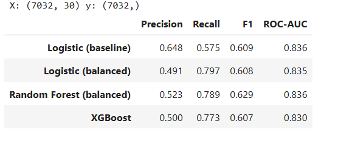
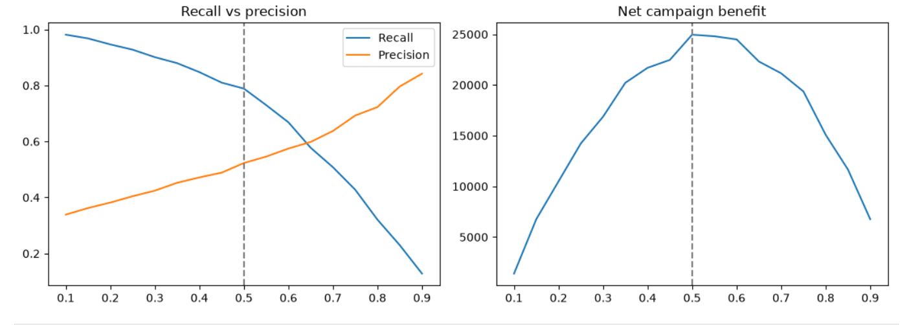
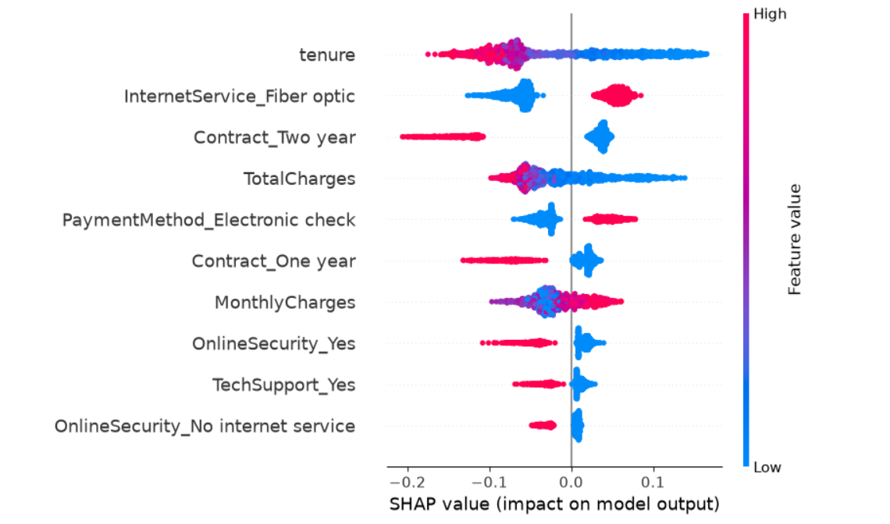
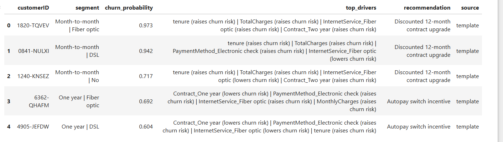

# Customer Churn Analysis: Who Leaves, Why, and What To Do About It

A telecom company wants to know which customers are likely to churn and why, so it can target retention offers before they leave. This project takes that from SQL segmentation through a tuned prediction model, SHAP explanations, a campaign ROI estimate, and an LLM-assisted retention recommender.

## Dataset

[Telco Customer Churn](https://www.kaggle.com/datasets/blastchar/telco-customer-churn) (IBM sample dataset via Kaggle): 7,043 customers with demographic, account and service information. 11 rows had blank `TotalCharges` (new customers) and were dropped, leaving **7,032** customers. Overall churn rate: **26.6%**.

## Key Findings (SQL analysis)

All queries are in [`sql/`](sql/) and run on SQLite (`data/churn.db`).

| Segment | Churn rate |
|---|---|
| Month-to-month contract | 42.7% |
| One-year contract | 11.3% |
| Two-year contract | 2.8% |
| Tenure 0-12 months | 47.7% |
| Tenure 49+ months | 9.5% |
| No tech support (internet customers) | 41.6% |
| With tech support | 15.2% |
| Electronic check payers | 45.3% |
| Other payment methods | 15.3% - 19.2% |

**Where the money is lost.** Churned customers represented about **$139K in monthly revenue**. Month-to-month customers account for roughly 87% of it ($120.8K).

**Riskiest segment (CTE + window-function query).** Month-to-month customers on **fiber optic** churn at **54.6%** (2,128 customers), and they account for about **$100.5K of the monthly revenue lost**, around 72% of the total. This is the single segment to prioritize.

## Modeling

Split: 80/20 stratified, `random_state=42`. Test set: 1,407 customers. Default threshold 0.5 in the table below.

| Model | Precision | Recall | F1 | ROC-AUC |
|---|---|---|---|---|
| Logistic Regression (baseline) | 0.648 | 0.575 | 0.609 | 0.836 |
| Logistic Regression (class-balanced) | 0.491 | 0.797 | 0.608 | 0.835 |
| Random Forest (class-balanced) | 0.523 | 0.789 | 0.629 | 0.836 |
| XGBoost (`scale_pos_weight`) | 0.500 | 0.773 | 0.607 | 0.830 |



**Reading the table.** All four models rank customers about equally well (ROC-AUC 0.830-0.836), so the real difference is the precision/recall trade-off. Accuracy is misleading with a 26.6% churn rate, so I evaluate on recall and precision. Class weighting raises recall from about 0.58 to about 0.79 at the cost of precision, which suits a retention campaign where missing a churner usually costs more than a wasted offer. I chose **Random Forest (balanced)** for the best F1 and for direct SHAP support.

### Threshold chosen by business cost

Rather than assuming 0.5, I searched thresholds from 0.10 to 0.90 and picked the one that maximizes the estimated net benefit of a retention campaign. Under the cost assumptions below, that search landed on **0.50**, so class weighting alone was enough and no further threshold shift was needed.

- Chosen threshold: **0.50**
- At that threshold: recall **0.79**, precision **0.52**. Of 374 actual churners in the test set, 295 were caught and 79 missed; 269 loyal customers received an offer unnecessarily.



### Estimated campaign ROI (test set)

Assumptions (not measured, adjust to the business): customer value = 12 months of average monthly charges; offer cost = 10% discount for 12 months; offer saves 30% of contacted churners.

With these assumptions (customer value about $778, offer cost about $78):

- Targeting with the model: 564 offers sent, 295 churners reached, net benefit **$24,960**
- Offering to everyone: net benefit **-$22,161**

Targeting with the model turns a loss-making blanket campaign into a profitable one. These are estimates for the 1,407-customer test set, and they move directly with the assumed offer cost and success rate.

## Explainability (SHAP)



Each dot is a customer in the test set; points to the right push predicted churn risk up, points to the left push it down. The three strongest drivers are **tenure**, **fiber optic internet** and **contract type**. Short tenure raises risk and long tenure lowers it; having fiber optic raises risk; a two-year or one-year contract lowers it sharply. Paying by **electronic check** also raises risk, while **online security** and **tech support** lower it.

These drivers agree with the SQL findings above (for example, month-to-month fiber customers churn at 54.6% and electronic check payers at 45.3%), which is a good sign the model learned real patterns. `TotalCharges` is closely related to tenure, so its effect should not be read separately from tenure.

## LLM Retention Recommender

For each high-risk customer, the churn probability and top SHAP drivers are passed to an LLM, which must choose **one offer from a fixed list** and justify it using only those drivers. This prevents invented discounts. If no API key is set, a rule-based template is used so the project always runs.

Example output: [`data/sample_recommendations.csv`](data/sample_recommendations.csv)



## Churn Playbook

1. **Month-to-month fiber customers** (54.6% churn): offer a discounted contract upgrade early.
2. **Internet customers without tech support** (41.6% churn): free tech-support trial in months 2-3.
3. **Electronic check payers** (45.3% churn): incentive to switch to autopay.
4. **New customers (0-12 months)** (47.7% churn): early check-in call before the first renewal point.

## Project Structure

```
data/        raw CSV, churn.db, sample_recommendations.csv
sql/         analysis queries (7 files)
notebooks/   01_eda_and_modeling.ipynb
app/         Streamlit app
images/      README screenshots
```

## Tech Stack

Python, Pandas, NumPy, SQLite, Scikit-learn, XGBoost, SHAP, Matplotlib, Seaborn, Streamlit, Claude API (optional, for recommendations)

## How to Run

```
pip install -r requirements.txt
jupyter notebook          # open notebooks/01_eda_and_modeling.ipynb and Run All
streamlit run app/app.py  # run from the project root
```

To enable LLM recommendations: `pip install anthropic` and set the `ANTHROPIC_API_KEY` environment variable. Without it, the template fallback is used.

## Limitations and Next Steps

- ROI figures rely on assumed offer cost and success rate; real values would come from an A/B test.
- Only one train/test split was used; cross-validation would give more stable estimates.
- Hyperparameters were set by hand, not tuned.
- The Telco dataset is a static sample; real churn work would add time-based features and validate on a later period.
